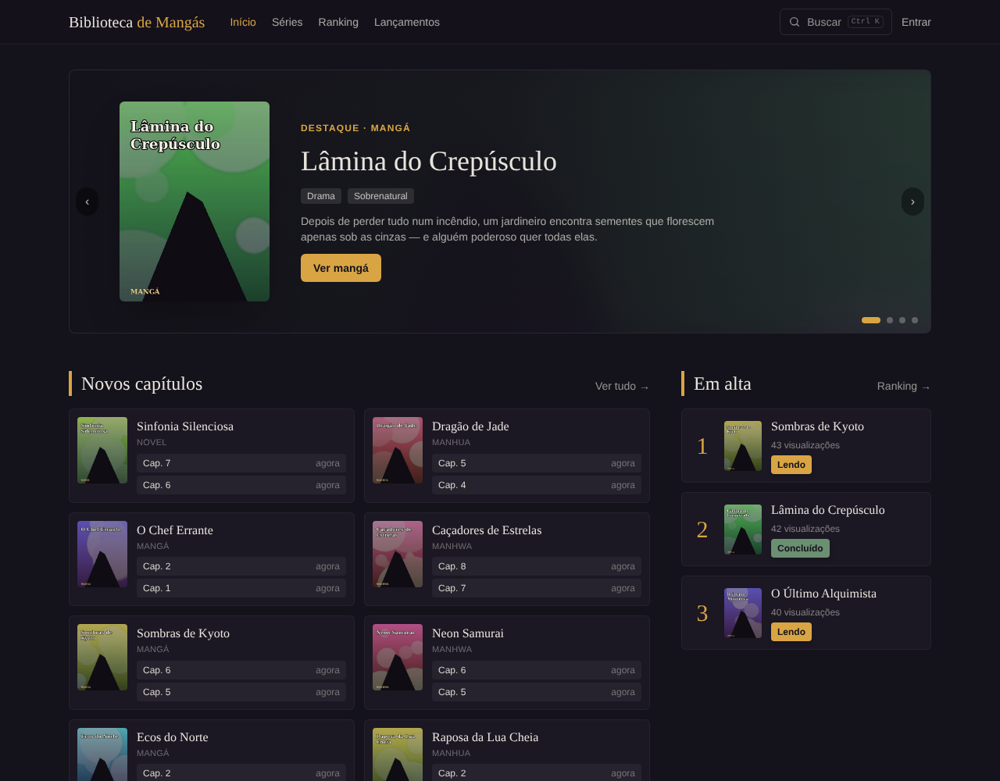
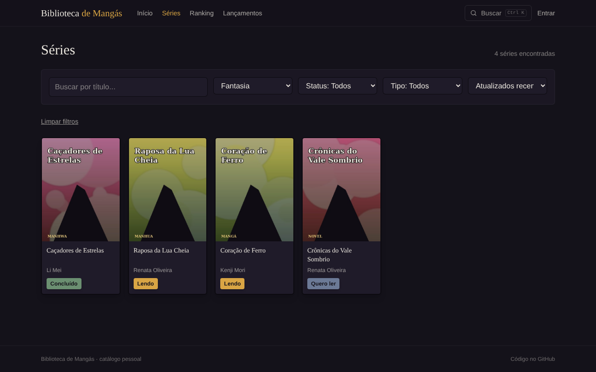
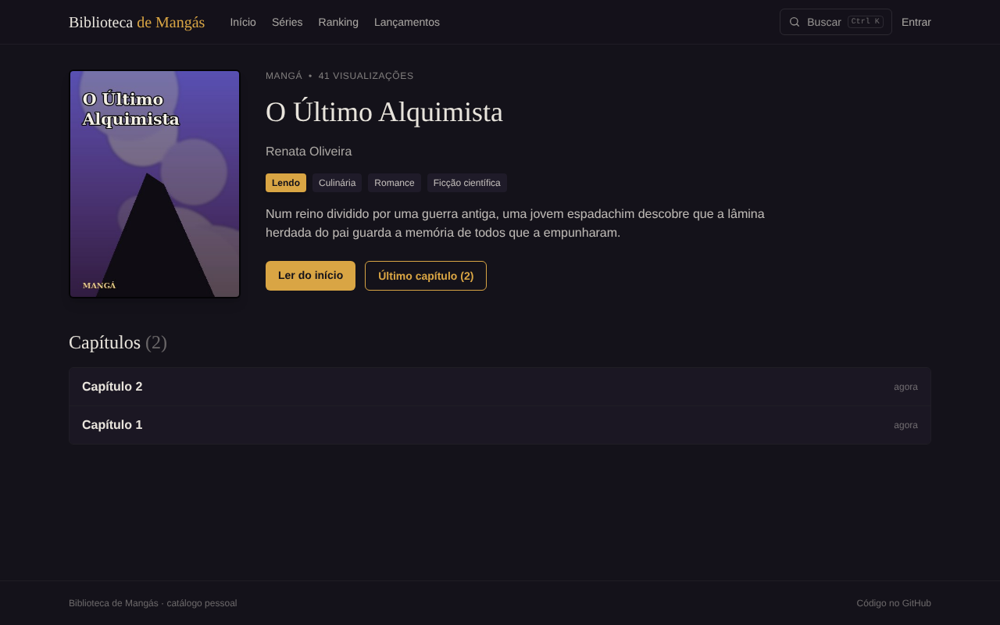
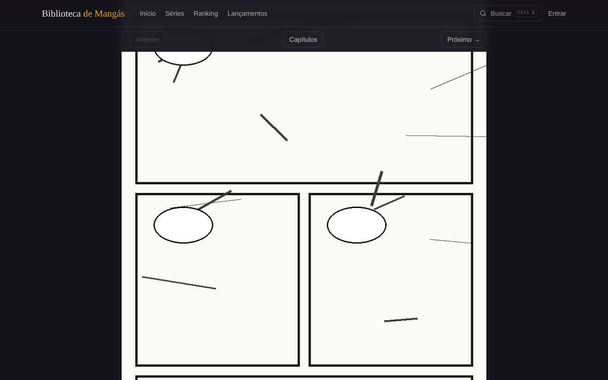
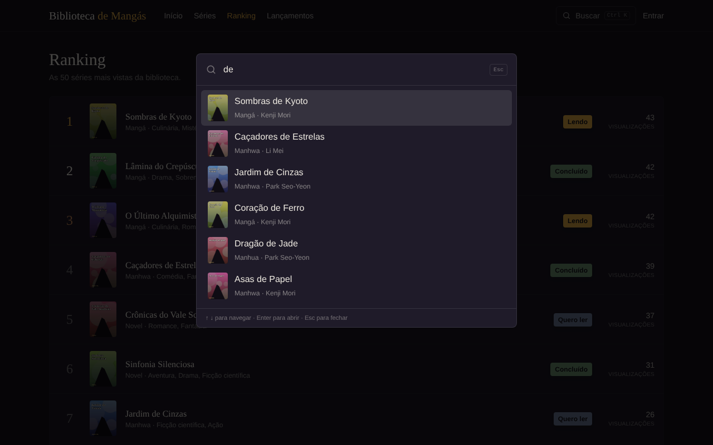

<h1 align="center">📚 Biblioteca de Mangás</h1>

<p align="center">
  Aplicação completa para catalogar e ler mangás: uma API REST em FastAPI e um site de leitura em React, com catálogo, ranking, leitor de capítulos e área de administrador.
</p>

<p align="center">
  
  
  
  
  
  
</p>

<p align="center">
  
</p>

> ✅ **Projeto funcional:** a API e o site de leitura estão completos e testados. As próximas melhorias estão em [Próximos passos](#proximos-passos).

<p align="center">
  
</p>

---

## 📖 Sobre o projeto

O **Biblioteca de Mangás** é um projeto pessoal criado para organizar e consultar uma coleção de mangás: título, autor, gênero, sinopse, status de leitura (quero ler / lendo / concluído) e os capítulos de cada obra.

O visual segue o estilo dos sites de leitura de mangá: página inicial com destaques e lançamentos, catálogo com filtros, ranking e um leitor de capítulos em rolagem vertical. Qualquer pessoa pode navegar e ler; só o administrador cadastra e edita.

O objetivo é praticar o desenvolvimento de uma aplicação completa, do banco de dados à interface, com atenção a segurança, testes e organização de código — servindo também como projeto de portfólio.

## 🚀 Funcionalidades

**Site (React)**
- ✅ Página inicial com banner de destaques, novos capítulos, séries em alta e adicionadas recentemente
- ✅ Catálogo com busca, filtros (gênero, status, tipo), ordenação e paginação guardados na URL
- ✅ Busca rápida com o atalho **Ctrl+K**, navegável pelo teclado
- ✅ Ranking das séries mais vistas e página de lançamentos
- ✅ Leitor de capítulos em rolagem vertical, com anterior/próximo pelas setas **← →** e progresso de leitura salvo
- ✅ Área do administrador: cadastro, edição e exclusão de mangás e capítulos (páginas coladas uma URL por linha)
- ✅ Layout responsivo com menu para celular, carregamento com *skeletons* e avisos de sucesso/erro

**API (FastAPI)**
- ✅ CRUD completo de mangás e capítulos (1:N), com as páginas de imagem de cada capítulo
- ✅ Busca com filtros combináveis (título, autor, gênero, status, tipo), ordenação e paginação
- ✅ Ranking por visualizações, destaques, mangás atualizados, lançamentos e lista de gêneros
- ✅ Login de administrador com JWT: leitura pública, escrita protegida
- ✅ Testes automatizados com pytest (SQLite e MySQL/MariaDB)
- ✅ Documentação automática via Swagger

## 📸 Capturas de tela

> Dados e capas fictícios, criados só para as demonstrações.

| Catálogo com filtros | Página do mangá |
|---|---|
|  |  |
| **Leitor de capítulos** | **Busca rápida (Ctrl+K)** |
|  |  |

<p align="center">
  
</p>

## 🛠️ Tecnologias utilizadas

**Back-end**
- [Python](https://www.python.org/)
- [FastAPI](https://fastapi.tiangolo.com/)
- [SQLAlchemy](https://www.sqlalchemy.org/) (ORM)
- [Pydantic](https://docs.pydantic.dev/) (validação de dados)
- [MySQL](https://www.mysql.com/) (banco de dados)
- [PyJWT](https://pyjwt.readthedocs.io/) + [bcrypt](https://pypi.org/project/bcrypt/) (autenticação)
- [SlowAPI](https://slowapi.readthedocs.io/) (limite de requisições)
- [pytest](https://docs.pytest.org/) (testes)

**Front-end**
- [React](https://react.dev/) 19
- [Vite](https://vite.dev/) (build e servidor de desenvolvimento)
- [Tailwind CSS](https://tailwindcss.com/) v4 (estilos)
- [React Router](https://reactrouter.com/) (rotas)
- [Axios](https://axios-http.com/) (requisições à API)
- [ESLint](https://eslint.org/) com as regras de hooks do React

## 📂 Estrutura do projeto

```
biblioteca-de-mangas/
├── backend/
│   ├── app/
│   │   ├── main.py          # ponto de entrada da API
│   │   ├── database.py      # conexão com o MySQL
│   │   ├── criar_admin.py   # script para criar o administrador
│   │   ├── core/            # configurações, segurança (JWT/bcrypt) e rate limit
│   │   ├── models/          # tabelas (SQLAlchemy)
│   │   ├── schemas/         # validação de dados (Pydantic)
│   │   ├── routers/         # rotas da API
│   │   └── crud/            # funções de acesso ao banco
│   ├── migrations/          # scripts SQL para atualizar um banco já existente
│   ├── tests/               # testes automatizados (pytest)
│   ├── .env.example         # modelo das variáveis de ambiente
│   └── requirements.txt
├── frontend/
│   ├── src/
│   │   ├── api/             # chamadas à API (axios, token e sessão expirada)
│   │   ├── components/      # peças reaproveitáveis (cards, formulários, busca rápida...)
│   │   ├── context/         # login do administrador e avisos (toasts)
│   │   ├── hooks/           # carregamento de dados e atalho Ctrl+K
│   │   ├── pages/           # uma página por rota
│   │   └── utils/           # datas, números, URL e opções compartilhadas
│   └── .env.example         # endereço da API
└── docs/screenshots/        # imagens deste README
```

## ⚙️ Como rodar o projeto

### Pré-requisitos
- Python 3.12+
- MySQL rodando localmente
- Node.js (para o front-end)

### Back-end

```bash
cd backend
python -m venv venv
venv\Scripts\activate      # Windows
# source venv/bin/activate   # Mac/Linux

pip install -r requirements.txt
```

Crie o banco no MySQL:

```sql
CREATE DATABASE biblioteca_mangas;
```

Copie o modelo de variáveis de ambiente e preencha os valores:

```bash
copy .env.example .env     # Windows
# cp .env.example .env     # Mac/Linux
```

A `SECRET_KEY` pode ser gerada com:

```bash
python -c "import secrets; print(secrets.token_urlsafe(64))"
```

> A API não inicia sem uma `SECRET_KEY` segura. O arquivo `.env` fica fora do Git.

Se o banco já existia antes desta versão, rode o script `backend/migrations/001_estilo_olympus_e_admin.sql` (ele só adiciona colunas e tabelas, sem apagar dados).

Crie o administrador (a senha é digitada sem aparecer na tela):

```bash
python -m app.criar_admin
```

Rode a API:

```bash
uvicorn app.main:app --reload
```

A documentação interativa (Swagger) fica disponível em `http://127.0.0.1:8000/docs`. Para testar as rotas protegidas por lá, faça login em `POST /auth/login`, copie o `access_token` e cole no botão **Authorize**.

### Testes

```bash
pip install -r requirements-dev.txt
pytest
```

Os testes usam um banco SQLite temporário, sem tocar no MySQL.

### Front-end

```bash
cd frontend
npm install
copy .env.example .env     # Windows (Mac/Linux: cp .env.example .env)
npm run dev
```

O site abre em `http://localhost:5173`. Para entrar como administrador, clique em **Entrar** e use o usuário criado com `python -m app.criar_admin`.

| Variável | Para que serve | Padrão |
|---|---|---|
| `VITE_API_URL` | Endereço da API | `http://127.0.0.1:8000` |

Outros comandos: `npm run lint` (verifica o código) e `npm run build` (gera a versão de produção em `dist/`).

### Atalhos do site

| Atalho | Onde | O que faz |
|---|---|---|
| `Ctrl` + `K` | qualquer página | Abre a busca rápida (`↑` `↓` escolhem, `Enter` abre, `Esc` fecha) |
| `←` / `→` | leitor | Capítulo anterior / próximo |

## 📌 Endpoints principais

🔒 = exige login de administrador (`Authorization: Bearer <token>`)

| Método | Rota | Descrição |
|--------|------|-----------|
| POST | `/auth/login` | Login do administrador (retorna o token JWT) |
| GET | `/auth/me` 🔒 | Dados do administrador logado |
| GET | `/mangas/` | Lista mangás (filtros, ordenação e paginação) |
| GET | `/mangas/ranking` | Mais vistos |
| GET | `/mangas/destaques` | Mangás em destaque |
| GET | `/mangas/atualizados` | Mangás com capítulo novo, com os 2 últimos capítulos |
| GET | `/mangas/generos` | Lista de gêneros cadastrados |
| GET | `/mangas/{id}` | Mangá com a lista de capítulos |
| POST | `/mangas/` 🔒 | Cadastra um mangá |
| PUT | `/mangas/{id}` 🔒 | Atualiza um mangá |
| DELETE | `/mangas/{id}` 🔒 | Remove um mangá (e seus capítulos) |
| POST | `/mangas/{id}/visualizar` | Conta uma visualização |
| GET | `/capitulos/recentes` | Últimos capítulos lançados (paginado) |
| GET | `/capitulos/manga/{manga_id}` | Capítulos de um mangá |
| GET | `/capitulos/{id}` | Capítulo com páginas e navegação (anterior/próximo) |
| POST | `/capitulos/` 🔒 | Cadastra um capítulo |
| PUT | `/capitulos/{id}` 🔒 | Atualiza um capítulo |
| PUT | `/capitulos/{id}/paginas` 🔒 | Define as páginas (URLs das imagens) |
| DELETE | `/capitulos/{id}` 🔒 | Remove um capítulo |
| POST | `/capitulos/{id}/visualizar` | Conta uma leitura |

## 🔐 Segurança

**API**
- Senhas guardadas apenas como hash **bcrypt**; login com token **JWT** assinado e com expiração.
- Rotas de escrita protegidas; leitura pública.
- Validação de todos os dados de entrada (tamanhos, valores permitidos, campos extras recusados).
- URLs de imagens aceitas só com `http`/`https`, bloqueando `javascript:` e `data:` (XSS).
- Consultas via ORM (sem SQL montado à mão) e curingas `%`/`_` escapados nas buscas.
- Limite de tentativas de login e de contagem de visualizações por IP.
- CORS restrito às origens configuradas e cabeçalhos de segurança nas respostas.
- Erros internos não expõem detalhes do servidor.
- Segredos só em variáveis de ambiente; dependências com versões fixadas e auditadas com `pip-audit` e `npm audit`.

**Site**
- Token guardado no `sessionStorage` (some ao fechar a aba) e descartado automaticamente quando a API responde 401.
- Páginas de administrador bloqueadas sem login (a proteção de verdade continua na API).
- Nenhum HTML vindo da API é injetado na página (sem `dangerouslySetInnerHTML`); imagens só de endereços `http`/`https`.
- Parâmetros lidos da URL (filtros, página) validados contra os valores aceitos antes de chegar à API.
- Imagens externas carregadas sem enviar o endereço de origem (`referrer`), e links externos com `rel="noopener noreferrer"`.

<a id="proximos-passos"></a>

## 🗺️ Próximos passos

- [x] Interface completa em React (estilo site de leitura, com leitor de capítulos)
- [x] Autenticação de administrador
- [x] Catálogo, ranking, lançamentos e busca rápida
- [ ] Upload de imagem de capa e das páginas (hoje são cadastradas por URL)
- [ ] Contas de leitor, com progresso de leitura sincronizado entre dispositivos
- [ ] Testes automatizados do front-end (Vitest + Testing Library)
- [ ] Integração contínua (GitHub Actions rodando testes, lint e auditorias)
- [ ] Deploy da API e do site

## 👤 Autor

**Victor Hugo Sousa Oliveira**

[GitHub](https://github.com/ViktorHSO)
